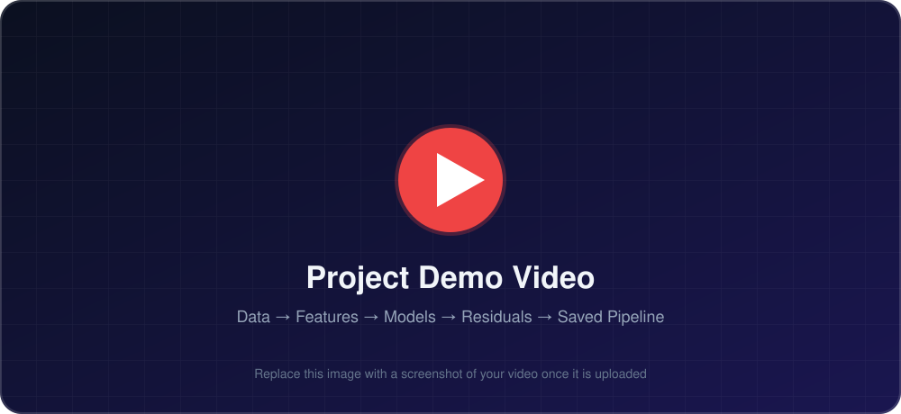
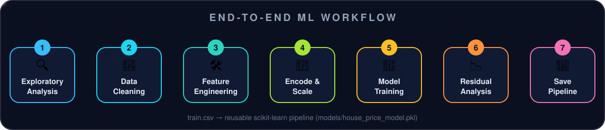
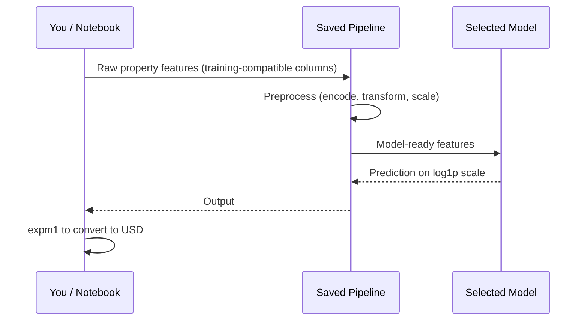

<div align="center">


<br>


<br>

<!--
  ▶▶▶ ADD YOUR VIDEO LINK HERE ◀◀◀
  Replace YOUR_VIDEO_LINK_HERE (below) with your YouTube / Loom / Google Drive / LinkedIn video URL.
  There is a second button in the "Demo Video" section further down; replace the link there too.
-->
<a href="YOUR_VIDEO_LINK_HERE">
  
</a>

<br><br>

**[Overview](#-project-overview)** &nbsp;•&nbsp;
**[Demo Video](#-demo-video)** &nbsp;•&nbsp;
**[Dataset](#-dataset)** &nbsp;•&nbsp;
**[Workflow](#-workflow-and-methodology)** &nbsp;•&nbsp;
**[Results](#-evaluation-and-results)** &nbsp;•&nbsp;
**[Insights](#-key-business-insights)** &nbsp;•&nbsp;
**[Run It](#-how-to-run-the-project)** &nbsp;•&nbsp;
**[Limitations](#-limitations)**

</div>


## 📌 Project Overview

A machine-learning regression project that **estimates residential sale prices from property characteristics**. It covers exploratory data analysis, data cleaning, feature engineering, preprocessing, model comparison, residual analysis, and saving a reusable prediction pipeline.

<div align="center">
  
</div>

<br>

| | |
|---|---|
| **Project status** | Educational / portfolio project |
| **Dataset** | Ames Housing (`train.csv`) |
| **Prediction target** | `SalePrice` |
| **Primary use case** | Estimate a property's sale price from its recorded attributes |
| **Models compared** | Linear, Ridge, Lasso, Random Forest, XGBoost |
| **Deliverable** | A fitted scikit-learn preprocessing-and-model pipeline saved with `joblib` |

The goal is to demonstrate a **complete, explainable workflow**: understand the data, prepare reliable features, train multiple candidate models, evaluate them on unseen test data, investigate residuals, and persist the selected pipeline. It does **not** claim the model is ready for commercial property valuation without further validation.


## 🎬 Demo Video

<div align="center">

<!--
  ▶▶▶ ADD YOUR VIDEO LINK HERE (second button) ◀◀◀
  Replace YOUR_VIDEO_LINK_HERE with the same video URL.
  Tip: After uploading, swap assets/video-thumbnail.svg for a real screenshot (e.g. assets/video-thumbnail.png) and update the src below.

  OPTION B – native GitHub player: edit this README on github.com, drag-and-drop your .mp4 into the editor,
  and GitHub will insert a link that plays inline. Paste that link on its own line where you want the player.
-->
<a href="YOUR_VIDEO_LINK_HERE">
  
</a>

<br><br>

<a href="YOUR_VIDEO_LINK_HERE">
  
</a>

</div>


## 💼 Business Problem

House prices depend on several interacting factors, including living area, overall quality, property age, location, and available facilities. Manual estimates may vary between people and can be time-consuming.

This project explores whether **historical housing data can produce consistent, data-driven price estimates**. In a real-estate workflow, such estimates could help professionals:

- 🔎 compare properties side by side,
- 🚩 identify listings that warrant closer review,
- 📐 establish an initial valuation range.

> [!IMPORTANT]
> A prediction should **support professional judgement**, not replace an inspection or a market appraisal.


## 🗂️ Dataset

| Item | Details |
|---|---|
| **Source** | [Kaggle – House Prices: Advanced Regression Techniques](https://www.kaggle.com/competitions/house-prices-advanced-regression-techniques/data) |
| **File used** | `train.csv` |
| **Target** | `SalePrice` (USD) |
| **Records** | 1,460 property records in the original training file |
| **Features** | Areas and rooms, quality and condition, construction and renovation dates, garages, basements, location, and other characteristics |
| **Data type** | Mix of numerical and categorical columns |

> [!NOTE]
> Sign in to Kaggle and accept the competition rules if prompted before downloading the data.

The dataset is historical and reflects its original market context. Prices should **not** be treated as current market values without testing on newer, geographically relevant data.


## 🔬 Workflow and Methodology

```mermaid
flowchart LR
    A[("train.csv<br/>1,460 rows")] --> B["Exploratory<br/>Data Analysis"]
    B --> C["Data Cleaning<br/>missing values + outliers"]
    C --> D["Feature Engineering<br/>TotalSF · HouseAge · RemodAge<br/>HasGarage · HasPool"]
    D --> E["Encoding + Scaling<br/>ordinal · one-hot · log1p · StandardScaler"]
    E --> F{{"5 Candidate Models"}}
    F --> G["Evaluation<br/>RMSE · MAE · R² · 5-fold CV"]
    G --> H["Residual Analysis<br/>+ Feature Importance"]
    H --> I[("house_price_model.pkl")]

    style A fill:#0ea5e9,color:#fff,stroke:#0369a1
    style F fill:#f59e0b,color:#111,stroke:#b45309
    style G fill:#8b5cf6,color:#fff,stroke:#6d28d9
    style I fill:#ec4899,color:#fff,stroke:#be185d
```

<div align="center">
  
</div>

<br>



<details>
<summary><b>1️⃣ Exploratory Data Analysis</b></summary>

<br>

The initial analysis reviews the dataset's dimensions, column types, summary statistics, missing values, numerical distributions, categorical counts, correlations, and relationships between selected property features and `SalePrice`. Histograms, boxplots, scatterplots, and a correlation heatmap are used to identify patterns and potential data-quality issues.

</details>

<details>
<summary><b>2️⃣ Data Cleaning</b></summary>

<br>

Missing values are handled according to the **meaning of each feature**:

| Situation | Treatment |
|---|---|
| Missing category that indicates an absent facility | Represented as `None` |
| Numerical value representing an absent facility | May be filled with `0` |
| Remaining numerical missing values | Filled with the **median** |
| Remaining categorical missing values | Filled with the **mode** |
| Columns with more than **80%** missing values | Removed (project rule) |

Two unusual observations matching `GrLivArea > 4000` **and** `SalePrice < 300000` are removed as specified in the practical. This rule is a project-specific decision and should be reviewed before applying the workflow to other datasets.

</details>

<details>
<summary><b>3️⃣ Feature Engineering</b></summary>

<br>

New features make property characteristics easier for models to use:

| Feature | Meaning |
|---|---|
| `TotalSF` | Combines basement, first-floor, and second-floor areas |
| `HouseAge` | Years between the sale year and original construction year |
| `RemodAge` | Years between the sale year and the most recent remodelling year |
| `HasGarage` | Indicates whether garage area is greater than zero |
| `HasPool` | Indicates whether pool area is greater than zero |

</details>

<details>
<summary><b>4️⃣ Encoding, Transformation, and Scaling</b></summary>

<br>

- **Ordinal encoding** for quality-related columns, using the defined quality order.
- **One-hot encoding** for nominal categorical columns with up to ten unique values (high-cardinality handling is documented in the notebook).
- **`log1p` transform** for positively skewed numerical features, based on the selected skewness threshold.
- **`StandardScaler`** for continuous numerical features.
- **Target transform:** `SalePrice` is trained on the `log1p` scale. Predictions are converted back with `expm1` before reporting RMSE and MAE in USD.

</details>

<details>
<summary><b>5️⃣ Model Training and Comparison</b></summary>

<br>

Five candidate models are compared using test-set **RMSE, MAE, and R²**. Five-fold cross-validation assesses consistency, `RandomizedSearchCV` tunes Random Forest hyperparameters, and training time is recorded to support practical model selection.

</details>

<details>
<summary><b>6️⃣ Residual Analysis and Interpretation</b></summary>

<br>

Residuals are examined with:

- a **residuals-versus-fitted** plot (patterns and uneven error spread),
- a **histogram** (skewness),
- a **Q-Q plot** (departures from normality and unusually large errors).

Feature-importance analysis identifies attributes that are useful to the selected model. **Importance is predictive, not proof of causation.**

</details>

<details>
<summary><b>7️⃣ Model Persistence</b></summary>

<br>

The selected model and its preprocessing steps are stored together as a reusable scikit-learn pipeline in `models/house_price_model.pkl`. The saved pipeline is reloaded and tested on five sample rows, with predicted prices compared against actual prices.

</details>


## 🤖 Models Evaluated

| # | Model | Purpose |
|:-:|---|---|
| 1 | **Linear Regression** | Establish a baseline and provide a relatively interpretable reference |
| 2 | **Ridge Regression** | Test whether L2 regularization improves generalization |
| 3 | **Lasso Regression** | Test L1 regularization, which can shrink some coefficients to zero |
| 4 | **Random Forest** | Capture non-linear relationships and feature interactions |
| 5 | **XGBoost** | Evaluate gradient boosting for potentially stronger predictive performance |

> [!NOTE]
> No model should be described as the winner until the final notebook comparison table has been run and reviewed.


## 📊 Evaluation and Results

Models were evaluated on a **held-out 20% test set**. RMSE and MAE are reported on the original `SalePrice` scale after reversing the target's `log1p` transformation with `expm1`. Five-fold cross-validation RMSE is also calculated on the original price scale using the training split.

<div align="center">
  
</div>

<br>

### Full comparison (reproducible run of the documented workflow)

| Model | Test RMSE (USD) | Test MAE (USD) | Test R² | 5-Fold CV RMSE (USD) | CV Std. Dev. (USD) | Training Time (s) |
|---|--:|--:|--:|--:|--:|--:|
| Linear Regression | $22,764.58 | $15,879.28 | 0.9062 | $25,762.58 | $2,859.86 | 0.08 |
| Ridge Regression | $20,595.72 | $14,736.92 | 0.9232 | **$22,379.08** | **$1,556.51** | 0.21 |
| Lasso Regression | $20,052.30 | $14,656.85 | 0.9272 | $22,964.78 | $2,019.67 | 0.33 |
| Random Forest | $23,083.16 | $16,207.00 | 0.9035 | $27,604.62 | $3,354.20 | 1.08 |
| 🏆 **XGBoost** | **$19,541.55** | **$14,227.51** | **0.9309** | $24,165.82 | $3,967.83 | 0.45 |

### 🏆 Best model

**XGBoost** was the best model by held-out **test RMSE** in this run:

| Metric | Value | Plain-English meaning |
|---|--:|---|
| Test RMSE | **$19,541.55** | Typical error, with large misses penalized more strongly |
| Test MAE | **$14,227.51** | Average absolute error is about **$14.2k** on this test split |
| Test R² | **0.9309** | Explains about **93.1%** of the variation in test-set sale prices |
| 5-Fold CV RMSE | $24,165.82 ± $3,967.83 | Higher than the test RMSE, so performance varies across folds |

> [!TIP]
> **Reading the table honestly:** XGBoost wins on the held-out test split, but **Ridge Regression has the lowest cross-validated RMSE ($22,379.08) and the smallest fold-to-fold variation ($1,556.51)**. XGBoost's CV standard deviation is the largest of the five models. Confirm the choice on more data before any production use.

<details>
<summary><b>📖 How to read the metrics</b></summary>

<br>

- **RMSE:** penalizes larger prediction errors more strongly and is expressed in the original price units.
- **MAE:** the average absolute prediction error in the original price units.
- **R²:** the proportion of test-target variation explained relative to a mean-baseline model; higher is generally better.
- **Training time:** machine- and environment-dependent; treat it as indicative, not as a universal benchmark.

</details>

> [!WARNING]
> Your own notebook may produce slightly different results if package versions, preprocessing order, random seeds, or hardware differ. These figures were calculated by rerunning the documented preprocessing and model settings on the supplied `train.csv`. **Replace them if your final notebook's `model_comparison.csv` reports different values.**

> [!NOTE]
> **Currency:** Ames Housing `SalePrice` is dollar-denominated. All results above are in **USD, not INR**. Convert to INR only if you state the exchange rate and date used.


## 💡 Key Business Insights

<div align="center">
  
</div>

<br>

| Rank | Feature | Importance | What it suggests for a property professional |
|:-:|---|--:|---|
| 🥇 | `OverallQual` | **0.1844** | Overall material and finish quality was the strongest predictor in this run, so assess build and finish quality consistently when comparing similar homes. |
| 🥈 | `TotalSF` | **0.1379** | Combined basement and floor area ranked second; total usable area helps distinguish properties with different amounts of living space. |
| 🥉 | `ExterQual` | **0.0579** | Exterior material and finish quality ranked third; recording exterior condition consistently supports better comparisons between listings. |

> [!CAUTION]
> These are **model-specific importance scores**, not causal effects or percentage changes in price. Interpret them alongside property context and local market information.


## 🧱 Project Structure

A recommended structure:

```text
house-price-prediction/
├── train.csv
├── house_price_prediction.ipynb
├── summary_report.md
├── README.md
├── requirements.txt
├── house_price_model.pkl              # optional: if saved in the project root
├── assets/                            # README visuals (animated SVGs)
│   ├── banner.svg
│   ├── pipeline.svg
│   ├── rmse-chart.svg
│   ├── feature-importance.svg
│   ├── kpi-cards.svg
│   ├── divider.svg
│   ├── watch-demo-button.svg
│   └── video-thumbnail.svg
├── models/
│   └── house_price_model.pkl          # final saved pipeline
└── outputs/
    ├── model_comparison.csv
    ├── missing_values_report.csv
    ├── cleaned_house_data.csv          # if retained
    ├── house_data_without_outliers.csv # if retained
    └── graphs/
        ├── missing_values_percentage.png
        ├── missing_values_before_after.png
        ├── feature_engineering.png
        ├── linear_regression_actual_vs_predicted.png
        ├── ridge_top20_coefficients.png
        ├── random_forest_top15_importances.png
        ├── xgboost_top15_importances.png
        ├── best_model_actual_vs_predicted.png
        ├── residuals_vs_fitted.png
        ├── residuals_histogram.png
        └── residuals_qq_plot.png
```

> This is a recommended layout, not a guarantee that every listed file exists. Keep only the files that are present in your repository and update the notebook filename if yours is different.


## 🧰 Requirements

| Library | Used for |
|---|---|
| **pandas**, **NumPy** | Data handling |
| **Matplotlib**, **Seaborn** | Visual analysis |
| **scikit-learn** | Preprocessing, pipelines, models, and evaluation |
| **XGBoost** | Gradient boosting |
| **joblib** | Saving and loading the model |
| **SciPy** | Statistical plots and analysis |
| **Jupyter Notebook** | Running the workflow |

Use the package versions that match the environment in which the saved model was trained. Scikit-learn pipelines serialized with `joblib` may not be compatible across arbitrary library versions.


## 🚀 How to Run the Project

**Quick start**

```bash
# 1. Get the project
git clone https://github.com/YOUR_USERNAME/house-price-prediction.git
cd house-price-prediction

# 2. Create and activate a virtual environment
python -m venv .venv
source .venv/bin/activate          # Windows: .venv\Scripts\activate

# 3. Install dependencies
pip install -r requirements.txt

# 4. Launch the notebook
jupyter notebook house_price_prediction.ipynb
```

<details>
<summary><b>📦 Example <code>requirements.txt</code> (pin the versions from your working environment)</b></summary>

<br>

```text
pandas
numpy
matplotlib
seaborn
scikit-learn
xgboost
joblib
scipy
notebook
```

If `requirements.txt` is not present yet, create it from the compatible versions used by your working notebook environment (for example with `pip freeze`).

</details>

**Step by step**

1. **Download or clone** the project and open its root folder in a terminal or IDE.
2. **Create and activate a virtual environment** so dependencies stay isolated.
3. **Install** the packages from `requirements.txt`.
4. **Place `train.csv`** in the project root, unless the notebook loads it from another location.
5. **Open** `house_price_prediction.ipynb` (or your actual notebook filename) in Jupyter.
6. **Run the notebook top to bottom.** Steps depend on earlier variables, so running cells out of order may cause errors.
7. **Review** the metrics, plots, comparison table, selected model, top features, and residual analysis.
8. **Check the saved pipeline:** confirm `models/house_price_model.pkl` exists and that the notebook can reload it and predict sample rows.

The notebook is the main entry point for reproducing training and evaluation. The `.pkl` file is the trained pipeline artifact; it is **not** a standalone application or web interface.


## 💾 Saved Model and Outputs

| Artifact | Description |
|---|---|
| `models/house_price_model.pkl` | Fitted preprocessing-and-model pipeline, if created by the notebook |
| `outputs/model_comparison.csv` | Model comparison table, if saved |
| `outputs/graphs/` | Visualizations generated by the analysis cells |
| `summary_report.md` | Concise project summary |

<details>
<summary><b>🧪 Example: reload the pipeline and predict</b></summary>

<br>



```python
import joblib
import numpy as np
import pandas as pd

model = joblib.load("models/house_price_model.pkl")      # load only from a trusted source

# Use rows with the same input columns as training (adjust to match your notebook)
sample = pd.read_csv("train.csv").drop(columns=["SalePrice"]).head(5)

log_pred = model.predict(sample)
price_usd = np.expm1(log_pred)     # skip this if your prediction wrapper already converts back

print(price_usd.round(2))
```

> If feature engineering (`TotalSF`, `HouseAge`, …) is performed outside the saved pipeline in your notebook, apply the same steps to new data before calling `predict`.

</details>

> [!CAUTION]
> Only load a saved model from a **trusted source**. It expects input columns compatible with the features used during training. Predictions are produced on the log-transformed target scale internally, so apply `expm1` when presenting prices in original units, unless the prediction wrapper already performs that conversion.


## ⚠️ Limitations

- 🕰️ The dataset is historical and may not represent current market conditions.
- ✂️ The train/test split and outlier-removal rule affect the reported results.
- 🔗 Feature importance does not establish causality.
- 🌍 Model quality may vary across locations, price ranges, and property types.
- 🧪 A model trained on one dataset should not be assumed to generalize to other regions without validation.

## 🛣️ Future Improvements

- [ ] Add recent transaction data and richer location information
- [ ] Validate on a time-based holdout
- [ ] Compare additional ensemble methods
- [ ] Tune hyperparameters with Bayesian optimization
- [ ] Calibrate prediction intervals
- [ ] Monitor model drift after deployment
- [ ] Production readiness: input validation, reproducible dependencies, model-version tracking, and periodic performance reviews


## 👤 Author

<div align="center">

**Roshan Marathe** &nbsp;•&nbsp; AI/ML Engineer &nbsp;•&nbsp; Surat, Gujarat, India

<!-- Replace the placeholders below with your real links -->
[](https://github.com/YOUR_USERNAME)
[](https://www.linkedin.com/in/YOUR_LINKEDIN)
[](mailto:YOUR_EMAIL)

<br>

<a href="YOUR_VIDEO_LINK_HERE">
  
</a>

<br><br>

⭐ If you found this project useful, consider giving it a star.

</div>

## 📜 Disclaimer

This project is for **educational and portfolio purposes**. Predictions are estimates based on historical data and should not be used as the sole basis for a real estate transaction, mortgage decision, or formal property valuation.


<div align="center">
  <sub>Built with Python · pandas · scikit-learn · XGBoost</sub>
</div>
